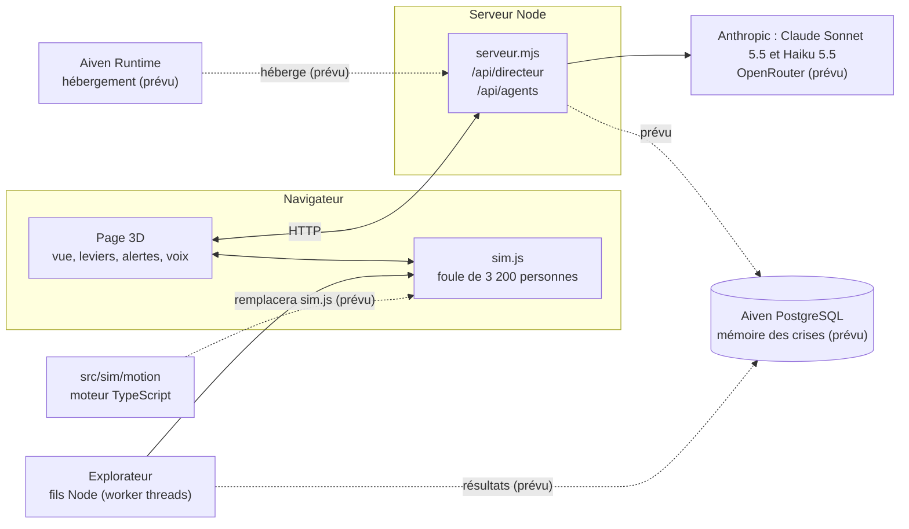

# Régie : le jumeau 3D du Forum des Halles pour décider en cas de crise

Un outil pour les sociétés de sécurité privée : il rejoue en 3D une foule dans un lieu réel, essaie des centaines de plans d'évacuation, et propose les trois meilleurs au chef de poste, qui garde la décision.


Projet du hackathon Accel AI Innovate: Paris (22 oct. 2026). Vocabulaire : [`GLOSSARY.md`](GLOSSARY.md).

## Sommaire
1. [Le problème](#le-problème)
2. [Ce que fait l'outil](#ce-que-fait-loutil)
3. [Architecture](#architecture)
4. [Est-ce réaliste ?](#est-ce-réaliste-)
5. [Lancer en local](#lancer-en-local)
6. [Déployer sur Aiven](#déployer-sur-aiven)
7. [L'équipe](#léquipe)
8. [Licences et données](#licences-et-données)

## Le problème

Le lundi 19 octobre 2026, vers 20 h, l'UGC Ciné Cité des Halles est évacué en pleine séance. Un couvre-feu préfectoral vient d'être annoncé (vers 19 h 20) et le centre commercial prévient le cinéma une demi-heure avant. Les stations du Forum ferment dans la soirée, des cortèges sont dans les rues. Le chef de poste de la société de sécurité décide seul, avec une radio et un plan papier, pour environ 3 000 spectateurs.
Sources : [`reports/etat-art-7-forum-des-halles.md`](reports/etat-art-7-forum-des-halles.md) (section 5, presse citée) et [`demo/SCRIPT.md`](demo/SCRIPT.md). Heure exacte de fermeture de chaque station : à confirmer.

| Qui paie | Pourquoi |
|---|---|
| Premier client visé : le directeur du Westfield Forum des Halles (URW) | Il a vécu la soirée du 19 oct. |
| Acheteur : les sociétés de sécurité privée (Securitas, Seris, Fiducial…) | Elles gèrent les crises sur place, pour de nombreux sites. |
| Plus grand marché : les grands lieux britanniques soumis à la Martyn's Law (2027), 24 300 lieux selon nos notes | Obligation légale de plan de réponse. Chiffre à confirmer. |

Détail : [`reports/qui-achete-synthese.md`](reports/qui-achete-synthese.md).

## Ce que fait l'outil

Le parcours suit [`demo/SCRIPT.md`](demo/SCRIPT.md) (3 minutes).

### 1. Un jumeau 3D du vrai lieu
Le Forum des Halles et Châtelet, d'après OpenStreetMap (3 013 bâtiments, 334 espaces intérieurs, niveaux 0 à -5, 528 portes, 107 escalators, 17 ascenseurs) et les accès voyageurs officiels d'Île-de-France Mobilités (IDFM). Quatre styles de rendu.


### 2. Une foule simulée en direct
3 200 personnes sur la vraie grille du lieu. Trois modèles publiés :

| Modèle | Rôle |
|---|---|
| Forces sociales de Helbing | Chaque personne est attirée vers sa sortie et repoussée par les autres et les murs. |
| Choix de sortie de Lovreglio | Chacun choisit sa sortie selon la familiarité, le suivisme, les zones à éviter. |
| Départ log-logistique | Le délai avant de se lever suit une loi mesurée (cinéma : médiane 40,5 s). |

Mesure en navigateur : 3,1 ms par pas de 0,1 s avec 3 200 personnes.


### 3. Contraintes imposées et leviers du directeur
Deux familles, qu'on ne mélange pas :

| Contraintes imposées (subies) | Leviers du directeur (choisis) |
|---|---|
| Stations fermées par la police, cortège ou manifestation, colis suspect, issue bloquée, escalator ou ascenseur en panne, annonce tardive | Fermer ou ouvrir une porte, placer un agent, diriger le public vers une sortie par une annonce, filtrer, évacuer par vagues |

Catalogues : [`reports/catalogue-perturbations.md`](reports/catalogue-perturbations.md), [`reports/catalogue-contraintes.md`](reports/catalogue-contraintes.md), [`reports/catalogue-decisions-leviers.md`](reports/catalogue-decisions-leviers.md).


### 4. L'explorateur : des centaines de scénarios, classés sur le pire cas
Chaque plan du directeur est joué contre 8 variantes qui cumulent 6 à 14 perturbations. Le plan est classé sur sa pire variante, pas sur sa moyenne. Le calcul tourne en parallèle sur les cœurs de la machine (fils Node, aucun appel payant, aucun modèle de langage dans le choix).

| Mesure (550 runs) | Meilleur plan | Plan comparé |
|---|---|---|
| Personnes envoyées vers les perturbations | 534 | 1 387 |
| Personnes pas encore sorties à 10 min | 132 | 245 |

Mesuré le 22 oct. sur un PC portable (i7, 16 fils de calcul) : 71 plans essayés, 550 simulations en 38 min, avec `node src/explorateur/explorer.mjs`. Le résultat (`resultats.json`) est une donnée générée, non commitée. Code : [`src/explorateur/`](src/explorateur/).


### 5. Onglet Décisions et bandes de contrôle
Trois colonnes : recommandées par le modèle, à prendre, prises. Dessous, une frise des événements en cours, colorée. Le chef de poste valide ; il n'y a pas de mode automatique. Disposition retenue : `reports/maquettes/design-regie/C-strips.html` (absent de `main` à ce jour : à confirmer).


### 6. Ordres à la voix
Le directeur parle, le navigateur transcrit, Claude Sonnet 5.5 transforme la phrase en actions (« une manifestation arrive rue Berger, ferme la porte Rambuteau »). Test de compréhension : 20 ordres sur 20 (à confirmer : `test-ordres.mjs` dans le dépôt en compte 11).


### 7. Des personnages à rôle pilotés par Claude Haiku
Environ 30 personnages (sécurité, pompiers, PC, RATP, police, individus influents) reçoivent une description de leur zone et choisissent une intention. Le moteur fait le mouvement. Chaque personne de la foule est cliquable et reçoit sa consigne.


### 8. Mur de caméras et frise des alertes
Le mur de caméras ([`reports/maquettes/commun/murs-cameras.js`](reports/maquettes/commun/murs-cameras.js)) montre un écran par niveau du Forum (0 à -5) et trois sur les sorties les plus chargées. La frise des alertes passe à l'orange à 3 personnes/m² et au rouge à 4 personnes/m².


Liste exacte des captures à prendre : [`docs/images/CAPTURES.md`](docs/images/CAPTURES.md).

## Architecture



| Composant | Où | État |
|---|---|---|
| Page 3D, leviers, alertes | `reports/maquettes/chatelet-3d/` | existe |
| Serveur Node : ordres et agents | `reports/maquettes/chatelet-3d/serveur.mjs` | existe |
| Moteur de foule `sim.js` | `reports/maquettes/chatelet-3d/sim.js` | existe |
| Moteur TypeScript | `src/sim/motion/` | existe, n'est pas encore le moteur de la démo |
| Explorateur | `src/explorateur/` | existe |
| Comportement et grille de critères | `src/sim/behavior/`, `src/sim/metrics/` | existe |
| Coque Vite/Node | `src/app/`, `Dockerfile` | existe |
| OpenRouter | clé fournie par Alexandre | prévu (pas dans le code de `main`) |
| PostgreSQL Aiven, mémoire des crises | branches `lot/aiven`, `proto/memoire` | prévu (pas sur `main`) |
| Aiven Runtime | `Dockerfile` prêt | prévu (pas encore déployé) |

Règle de convergence : à terme tout vit dans `src/` ([`reports/etat-convergence.md`](reports/etat-convergence.md)).

## Est-ce réaliste ?

Réponse courte : oui jusqu'à environ 1,5 personne/m², non au-delà de 2. Source : [`reports/validation-moteur-foule.md`](reports/validation-moteur-foule.md). Commande : `node src/explorateur/validation/valider.mjs` (40 s). Au-delà de 2 personnes/m², nos densités sont des seuils d'alerte, pas des mesures physiques.

| Mesure | Référence publiée | Notre moteur | Verdict |
|---|---|---|---|
| Vitesse à 0,5 / 1 / 1,5 p/m² | Weidmann : 1,30 / 1,06 / 0,81 m/s | 1,38 / 1,24 / 0,75 m/s | Correspond |
| Débit maximal d'un couloir | 1,3 p/m/s (Fruin, SFPE) | 1,24 | Correspond |
| Portes de 1,2 m et plus | 1,6 à 1,9 p/m/s | 1,31 à 1,84 | Correspond |
| Escalator | 1,0 à 1,4 p/s | 1,19 | Correspond |
| Escalier : débit | 1,0 à 1,3 p/m/s | 1,94 (c'est le paramètre) | Circulaire, ne prouve rien |
| Vitesse à 2 p/m² et plus | 0,6 m/s | 0,07 m/s et moins | Ne correspond pas |
| Deux flux qui se croisent | Files nettes | Pas de files, 31 % du flux seul | Ne correspond pas |
| Corps qui se recouvrent | Moins de 1 % | 2,7 % (courant), 55,7 % (dense) | Ne correspond pas |
| Portes de 0,8 et 1 m | 1,6 à 1,9 | 1,10 et 1,14 | Limite de la grille de 1 m |
| Temps d'évacuation sur la vraie carte | Aucune donnée de terrain | Non validé | À confirmer |

Des correctifs sont documentés dans le rapport, non appliqués (pas de temps de 0,05 s, règle de croisement, poids d'anisotropie, largeur des liens). Les références y sont citées de mémoire : à re-vérifier à la source. Les modèles d'évacuation s'écartent jusqu'à 30 % entre eux (RiMEA) : lire les écarts avant/après comme un ordre de grandeur.

### Cartographie : sources et limites

| Source | Ce qu'elle apporte | Limite |
|---|---|---|
| OpenStreetMap | Bâtiments, couloirs, portes, escalators, ascenseurs | Pas de plan de la galerie marchande ; niveaux -1 et -2 pauvres ; escaliers de secours de l'UGC absents ; hauteurs manquantes fixées à 18 m |
| IDFM, référentiel des accès | 16 accès voyageurs : numéro, coordonnées, lignes | Pas de niveau ni de largeur |
| IDFM, GTFS `pathways.txt` | Distances et durées entrée vers quai, pour contrôler nos trajets | Aucun escalator ni niveau |
| Plans SNCF de la gare | Niveaux -3 à -5 de la gare | Hors galerie marchande |
| Westfield / Visioglobe | Contrôle et recalage interne | Pas de licence ouverte, jamais montré au jury |

Dire « fidèle » pour les accès voyageurs, « approché » pour les boutiques et le cinéma. Détail : [`reports/plans-officiels-forum.md`](reports/plans-officiels-forum.md), [`reports/cartographie-precise-chatelet.md`](reports/cartographie-precise-chatelet.md).

## Lancer en local

Prérequis : Node 20 ou plus (24 pour les tests de comportement), Python 3, git.

```bash
git clone https://github.com/adembnn/hack-accel.git
cd hack-accel
npm install
```

**1. Générer les données** (non commitées, produites sur place) :
```bash
cd reports/maquettes/chatelet-3d
./recuperer-osm.sh          # télécharge les extraits OpenStreetMap dans data/ et construit scene.json
python3 build_scene.py      # reconstruit scene.json à la main si besoin (à confirmer : déjà appelé par le script précédent)
python3 build_navgrid.py    # grille praticable 1 m par niveau, liens verticaux, sorties : navgrid.json
./recuperer-textures.sh     # facultatif : 9 textures CC0 (5 Mo) ; sans elles, rendu procédural
```

**2. Clé Anthropic.** Crée un fichier `.env` à la racine du dépôt (il est dans `.gitignore`, ne le commite jamais) avec la variable `ANTHROPIC_API_KEY` renseignée. Sans clé, le serveur comprend les ordres par mots-clés ; `MOCK_AGENTS=1` simule les agents sans appel payant.

**3. Lancer la vue et le serveur :**
```bash
cd reports/maquettes/chatelet-3d
npm install
node serveur.mjs            # port 8767 (variable PORT_MAQUETTE pour le changer)
```
Puis ouvrir http://127.0.0.1:8767/chatelet-3d/index.html (le serveur sert `reports/maquettes/` ; port réglable par `PORT_MAQUETTE`).

**4. Explorateur de plans** (depuis la racine, calcul local, gratuit) :
```bash
node src/explorateur/explorer.mjs     # options : --plans 40 --mutants 6 --meilleurs 5 --fils N
node src/explorateur/validation/valider.mjs
```

**5. Vérifications :**
```bash
node tools/verif.mjs                  # doit être vert avant toute fusion
npm test                              # tests Vitest
npm run test:behavior                 # comportement (départ, choix de sortie) et grille de critères
npm run bench:avant-apres             # consigne du 19 oct. contre plan des décideurs, 20 graines, environ 15 s
cd reports/maquettes/chatelet-3d && node test-ordres.mjs    # 11 ordres réels, appel payant de quelques centimes
```

Le comportement humain (`src/sim/behavior/`) est un modèle simplifié, non certifié : ses réglages marqués « hypothèse » ne sont pas des mesures. Démo hors réseau : `?demo=1` (graine fixe, réponses IA en cache ; à confirmer dans la vue actuelle). Règles de travail de l'équipe : [`LISEZMOI.md`](LISEZMOI.md) et [`CLAUDE.md`](CLAUDE.md).

## Déployer sur Aiven

Le hackathon demande un déploiement sur Aiven Runtime avec la couche de données Aiven (ici PostgreSQL). Le [`Dockerfile`](Dockerfile) construit l'interface avec Vite puis lance `src/app/serveur.mjs` sur le port `PORT`.

TODO : pas à pas dans `reports/deploiement-aiven-runtime.md` (en cours de rédaction, absent du dépôt pour l'instant).

## L'équipe

| Qui | Lots |
|---|---|
| Adem | socle, jumeau 3D, pitch, explorateur |
| Titouan | décideurs, Aiven |
| Sullyvan | mouvement de foule |
| Alexandre | décision humaine, clé OpenRouter |

## Licences et données

| Donnée | Licence | Usage |
|---|---|---|
| OpenStreetMap | ODbL, © contributeurs OpenStreetMap | Utilisée et affichée |
| IDFM (accès, GTFS) | ODbL | Utilisée et affichée |
| Westfield / Visioglobe (plan du Forum) | Pas de licence ouverte | Usage interne de contrôle seulement, non redistribué |
| Textures Poly Haven, Kenney Mini Characters | CC0 | Utilisées |

Licence du code : à confirmer. Les données générées (`data/`, `scene.json`, `navgrid.json`) ne sont jamais commitées.
